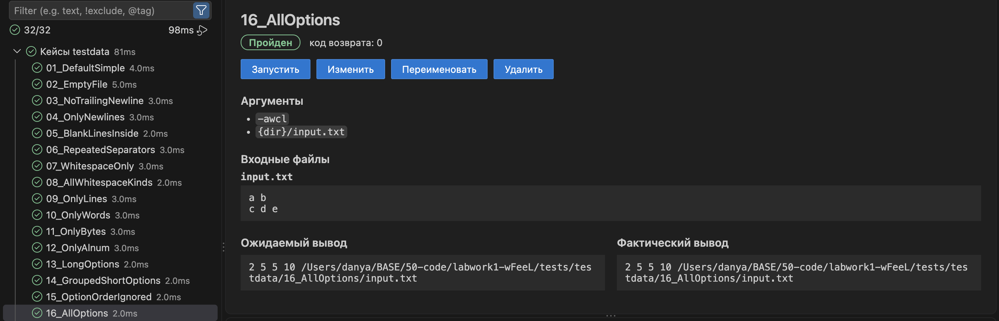
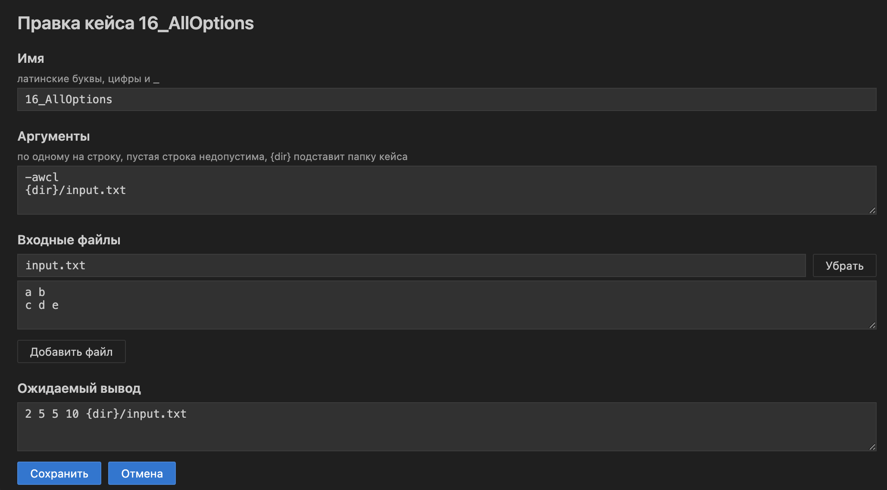
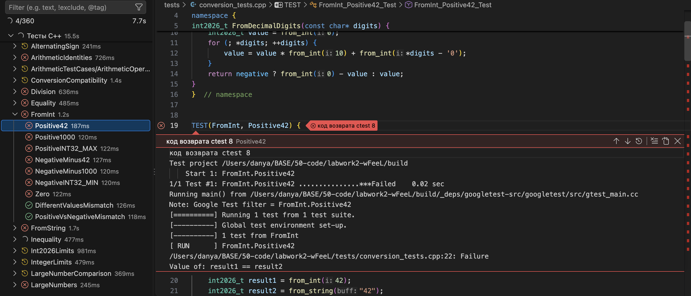
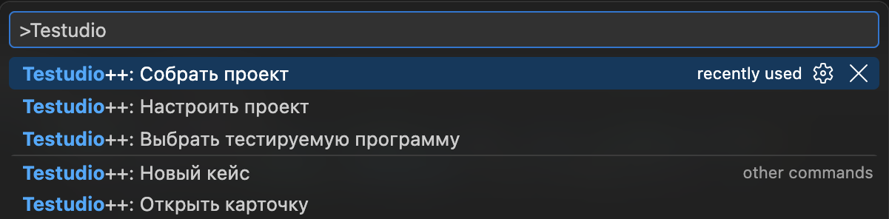

<div align="center">

# Testudio++

Расширение для VS Code: тесты проекта на CMake в панели Testing, запуск и правка кейсов с входными данными прямо в редакторе.


<br><br>

[Функционал](#-функционал) | [Установка](#-установка) | [Запуск](#-запуск) | [Как использовать](#-как-использовать) | [Настройки](#-настройки) | [Автор](#-автор)

<br><br>



</div>

## 🧩 Функционал

### 🌳 Дерево тестов и запуск

- Панель Testing показывает две группы: «Кейсы testdata» (кейсы с входными данными) и «Тесты C++» (тесты ctest по наборам). Пустая группа не показывается.
- Запускать можно все тесты сразу, группу или один тест.
- Дерево обновляется после сборки и само, когда меняется список тестов ctest.

### 🗂️ Карточка кейса

- Открывается кликом по кейсу, кнопкой в его строке или командой «Testudio++: Открыть карточку».
- Показывает имя, статус, код возврата, аргументы, входные файлы, ожидаемый и фактический вывод рядом.
- Кнопка «Diff» для упавшего кейса открывает встроенное сравнение ожидаемого и фактического вывода.
- Кнопка «Принять фактический вывод» заменяет `expected.txt` фактическим выводом после подтверждения.
- Нулевые байты, `\r` и байты вне UTF-8 видны в карточке как `\0`, `\r` и `\xNN`.

### ✏️ Создание и правка кейсов

- Кейс создается и правится формой в той же карточке.
- До записи на диск форма проверяет имя кейса (латинские буквы, цифры и `_`), аргументы (без пустых строк) и имена входных файлов (без `/`, без повторов, не `args.txt` и не `expected.txt`).
- Переименование и удаление кейса доступны из карточки, удаление еще и из дерева.



### 🧪 Тесты C++

- Тесты ctest показываются по наборам. Клик по тесту открывает его код, если плагин нашел в исходниках макрос `TEST`, `TEST_F` или `TEST_P` с таким именем (так устроены тесты gtest).
- При падении теста сообщение ctest и вывод gtest показываются прямо в редакторе, рядом со строкой теста.



### 🏗️ Настройка и сборка проекта

- Команды «Testudio++: Настроить проект» (`cmake -S . -B build`) и «Testudio++: Собрать проект» (`cmake --build`) запускаются из палитры команд.
- Если дерево пустое, плагин пишет почему и предлагает кнопку «Настроить и собрать» (проект не настроен) или «Собрать» (проект настроен, но тесты не собраны).
- Вывод cmake виден в окне «Testudio++». При ошибке его открывает кнопка «Показать вывод».

## 📦 Установка

| Что | Версия | Зачем |
|---|---|---|
|  | 1.100 или новее | редактор, в котором работает расширение |
|  | Node.js 22 или новее, npm идет в комплекте | сборка из исходников: `npm install`, `npm run compile`, `npx vsce package`. Для самой работы расширения не нужны |
|  | любая | `git clone` |
|  | 3.20 или новее, вместе с ctest | группа «Тесты C++» и команды «Настроить проект», «Собрать проект». Для кейсов testdata не нужен |

Поддерживаются macOS и Linux.

```bash
git clone https://github.com/wFeeL/Testudio.git
cd Testudio
npm install
```

## 🚀 Запуск

Способов два.

### Способ 1: из исходников

```bash
npm run compile
```

Откройте папку Testudio в VS Code и нажмите F5. Откроется отдельное окно «Extension Development Host» с подключенным расширением. В этом окне откройте свой CMake-проект.

### Способ 2: установить готовый файл `.vsix`

```bash
npm run compile
npx vsce package
code --install-extension testudio-0.1.0.vsix
```

`npx vsce package` создает файл `testudio-0.1.0.vsix`. Установить его можно и из интерфейса: панель Extensions, меню «...», «Install from VSIX...». После установки расширение работает в любом окне VS Code.

## 🧭 Как использовать

1. Откройте в VS Code папку проекта с `CMakeLists.txt` в корне и подтвердите доверие папке (Trust). Расширение включается, когда в корне открытой папки есть `CMakeLists.txt`. Плагин запускает программы и тесты проекта, поэтому в недоверенной папке он не работает. Поддерживается одна папка рабочей области.
2. Откройте панель Testing (значок колбы в боковой панели).
3. Если дерево пустое, нажмите «Настроить и собрать» или «Собрать» в подсказке плагина. То же делают команды из палитры: нажмите Cmd+Shift+P (macOS) или Ctrl+Shift+P (Linux), наберите `Testudio` и выберите «Testudio++: Настроить проект» и «Testudio++: Собрать проект». Вручную это `cmake -S . -B build` и `cmake --build build`.

   

4. Запустите тесты кнопками панели Testing: все сразу, группу или один тест.
5. При первом запуске кейса плагин спросит, какую программу тестировать. Сменить выбор можно командой «Testudio++: Выбрать тестируемую программу».
6. Кликните по кейсу, чтобы открыть его карточку.
7. Если кейс упал, нажмите «Diff», чтобы сравнить ожидаемый и фактический вывод. Если фактический вывод верный, нажмите «Принять фактический вывод».
8. Чтобы создать кейс, выполните команду «Testudio++: Новый кейс». Первый кейс создается только так: группа без кейсов скрыта, а папки с кейсами может еще не быть. Следующие кейсы можно создавать еще и правым кликом по группе «Кейсы testdata».
9. Правка, переименование и удаление кейса делаются кнопками «Изменить», «Переименовать» и «Удалить» в карточке. Удалить кейс можно и из дерева.
10. Для тестов C++ клик по тесту открывает его код. Проект плагин перед запуском не собирает: пересоберите его командой «Testudio++: Собрать проект».

## 📁 Формат кейса

Кейс это папка в `tests/testdata/` обычно с номером в начале имени, например `04_OnlyNewlines`. В ней лежат `args.txt` (аргументы по одному на строке), `expected.txt` (ожидаемый вывод) и входные файлы программы. Строка `{dir}` в `args.txt` и `expected.txt` означает путь к папке кейса.

```text
tests/testdata/04_OnlyNewlines/
  args.txt        {dir}/input.txt
  expected.txt    3 0 3 {dir}/input.txt
  input.txt
```

Кейс пройден, если программа завершилась с кодом 0, а вывод побайтово совпал с `expected.txt`. Программа запускается без оболочки и с пустым вводом в корне открытой папки. Не уложилась в таймаут, значит кейс упал.

## 🔧 Настройки

Обычно ничего менять не нужно, значения по умолчанию подходят для проекта со стандартной раскладкой. Если понадобится, откройте настройки VS Code (Cmd+, на macOS, Ctrl+, на Linux или меню Code/File, Settings), введите в поиск `testudio`. Все опции собраны в группе «Testudio++».

Чтобы задать значение только для одного проекта, переключитесь на вкладку Workspace или запишите ключи в файл `.vscode/settings.json` в корне проекта:

```json
{
  "testudio.buildDirectory": "build-debug",
  "testudio.timeoutSeconds": 30
}
```

<details>
<summary>Все настройки</summary>

| Ключ | По умолчанию | Что делает |
|---|---|---|
| `testudio.testdataPath` | `tests/testdata` | каталог с кейсами относительно корня открытой папки |
| `testudio.buildDirectory` | `build` | каталог сборки для `ctest` и `cmake --build` |
| `testudio.executablePath` | не задан | тестируемая программа; если путь не задан или файла нет, при первом запуске кейса откроется выбор файла |
| `testudio.cmakePath` | не задан | путь к `cmake` или его имя без `/`; если пусто, поиск в `PATH`, затем в `/opt/homebrew/bin`, `/usr/local/bin`, `/Applications/CMake.app/Contents/bin` |
| `testudio.ctestPath` | не задан | то же для `ctest` |
| `testudio.timeoutSeconds` | `10` | таймаут запуска одного теста в секундах |

</details>

## ⚠️ Ограничения

- Windows не проверялся.
- Поддерживается одна папка рабочей области, `CMakeLists.txt` должен лежать в ее корне.
- Если в `files.watcherExclude` исключен каталог сборки, дерево после сборки само не обновится, нажмите кнопку обновления в панели Testing.
- Править в форме можно только обычный текст: корректный UTF-8 без нулевых байтов и без `\r`, не больше 100000 байт. Остальные файлы остаются прежними.
- Тесты C++ плагин только показывает и запускает. Проект он не собирает перед запуском и `CMakeLists.txt` не меняет.

## 📄 Лицензия

MIT, текст в файле [LICENSE](LICENSE).

## 👤 Автор

<div align="center">

<a href="https://wfeels.site"></a>

Сабуров Даниил Денисович, M3109.

Лабораторная работа №3 по дисциплине «Инструментальные средства разработки ПО».

</div>
